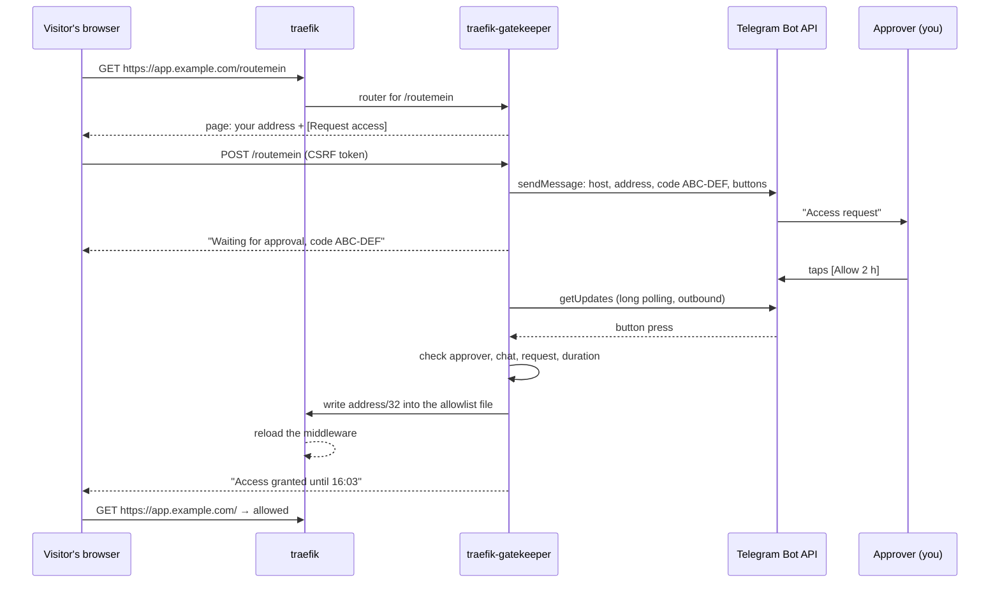

# traefik-gatekeeper

[](https://github.com/mkopnsrc/traefik-gatekeeper/actions/workflows/build.yml)

**Approve visitors to your [traefik](https://traefik.io)-protected sites from Telegram.**

A visitor opens `/routemein` on a protected site and presses **Request access**.
You get a Telegram message with buttons: **Allow 30 min · Allow 2 h · Allow 8 h · Deny**.
One tap, and the visitor's IP address is added to a traefik `ipAllowList`
middleware for that long, then removed automatically.

- Single static Go binary, ~12 MB distroless image (amd64 and arm64), one
  dependency (`gopkg.in/yaml.v3`).
- No database, no public admin endpoint, no inbound webhook.
- Built to face the internet: rate limits, CSRF protection, strict security
  headers, and nothing a visitor sends can reach the traefik configuration.

Inspired by [TraefikShaper](https://github.com/l4rm4nd/TraefikShaper) by
[l4rm4nd](https://github.com/l4rm4nd), which introduced the idea of granting
temporary access through traefik's `ipAllowList` on request. See
[Acknowledgements](#acknowledgements).

---

## Contents

- [How it works](#how-it-works)
- [Features](#features)
- [Security model](#security-model)
- [Requirements](#requirements)
- [Setup](#setup)
  - [1. Create the Telegram bot](#1-create-the-telegram-bot)
  - [2. Prepare files](#2-prepare-files)
  - [3. Run the container](#3-run-the-container)
  - [4. Configure traefik](#4-configure-traefik)
  - [5. Test it](#5-test-it)
- [Configuration reference](#configuration-reference)
- [Container usage](#container-usage)
- [Operations](#operations)
- [Troubleshooting](#troubleshooting)
- [Limitations](#limitations)
- [Development](#development)
- [Contributing and security](#contributing-and-security)
- [Acknowledgements](#acknowledgements)
- [License](#license)

---

## How it works



1. traefik routes `/routemein` (configurable) on each protected host to the
   gatekeeper. Every other path on those hosts goes through an `ipAllowList`
   middleware that the gatekeeper maintains.
2. The visitor's page shows their address and a button. Pressing it creates a
   request with a short code (for example `ABC-DEF`) and sends it to your
   Telegram chat. The visitor sees the same code, so you can check you're
   approving the right person.
3. The bot receives your button press by **long polling** (`getUpdates`), an
   outbound HTTPS connection. There is no webhook and no approve URL: nothing on
   the internet can approve a request except a button press from an authorised
   Telegram user in the configured chat.
4. The gatekeeper rewrites the middleware file with the approved addresses;
   traefik's file provider picks up the change within a second or two.
5. Every 30 seconds expired addresses are removed. The visitor's page updates by
   itself while waiting and shows the time left once allowed.

```text
                 ┌──────────────────────── your server ───────────────────────────┐
 browser ──► traefik ──► /routemein ──► traefik-gatekeeper ──► Telegram Bot API    │
                 │                            │       (outbound only)    ▲         │
                 │   middleware               │ writes                    │         │
                 │◄── gatekeeper-allowlist ◄──┴── gatekeeper-allowlist.yml│         │
                 │    (on protected routers)                              │         │
                 └────────────────────────────────────────────────────────┼─────────┘
                                                       your phone ── taps ┘
```

## Features

- **One-tap approvals** in Telegram from a fixed set of durations
  (`GK_DURATIONS`, up to four, e.g. `30m,2h,8h`) plus Deny.
- **Matching codes** on the visitor's page and in the request message.
- **Automatic expiry**: addresses are removed when their time is up.
- **Many sites, one instance**: every host in `GK_ALLOWED_HOSTS` (exact names or
  `.example.com` suffixes) can use the same gatekeeper.
- **IPv4 and IPv6** (`/32` and `/128` entries).
- **Survives restarts**: requests and grants are kept in `state.json`.
- **Audit log**: every request, decision, refused button press, expiry and
  error, one JSON line each, in `audit.log`.
- **Live page** (htmx): waiting, granted, denied and expired states without
  reloading; light and dark themes; mobile-friendly.
- **Always-allowed ranges** (`GK_BASE_RANGES`), e.g. a LAN or monitoring.
- **Hardened container**: distroless, non-root by default, read-only root
  filesystem, no capabilities, built-in health check. Multi-arch images with
  SBOM and build provenance.

## Security model

| Threat | Protection |
|---|---|
| Someone approves a request without you | Approval only through Telegram buttons, only from user IDs in `GK_TELEGRAM_APPROVERS`, only in `GK_TELEGRAM_CHAT_ID`. Other presses are refused and logged. There is no approve URL, so link previews, crawlers and leaked links can't approve anything. |
| Visitor picks a long duration | The duration comes from your button. A request carries no duration, and the button value must be one of `GK_DURATIONS`. |
| Flooding your phone | One pending request per address, `GK_REQUESTS_PER_IP_HOUR` per address and `GK_REQUESTS_PER_HOUR` in total. Reloads and double clicks never send a second message. Pending requests expire after `GK_PENDING_TTL`. |
| Requests triggered by other sites or links | The only state-changing request is a POST with a CSRF token (`__Host-` cookie, `SameSite=Strict`, `HttpOnly`) and an `Origin`/`Sec-Fetch-Site` check. GET never changes anything. |
| Spoofed client address | `X-Forwarded-For` is honoured only from `GK_TRUSTED_PROXIES`, and then the rightmost untrusted entry is used, so a visitor can't request access for another address. |
| Config injection | The allowlist is generated only from parsed IP addresses. Hostnames and browser strings are only displayed (escaped). At most `GK_MAX_ACTIVE` addresses. |
| Half-written config | A single write (`inplace`) or temp file + rename (`rename`), and only when the content changes. |
| Host header tricks, DNS rebinding | Unknown `Host` headers get `421`. Suffix entries match real subdomains only (`example.com.attacker.example` does not match `.example.com`). |
| Load | Per-address rate limit, cap on concurrent requests, 16 KiB body and header limits, short server timeouts. |
| Browser attacks | Strict CSP (`default-src 'none'`, no inline code), `frame-ancestors 'none'`, `nosniff`, HSTS, COOP/CORP, `noindex`. htmx runs with eval and script tags disabled. |
| Token leaks | The bot token is read from a file and never appears in logs or error messages (covered by a test). |

**What it is not:** an identity system. Access is granted to an **IP address**:
everyone behind that address (shared office NAT, public Wi-Fi, a VPN exit) gets
in for the approved window. For per-user authentication, use a login in front
(e.g. an OIDC forward-auth) instead of, or in addition to, this.

## Requirements

- traefik v3 (or v2.11+) with the **file provider** (`providers.file.directory`).
  The generated middleware uses the v3 name `ipAllowList`.
- Docker, Podman or another OCI runtime (or just the binary).
- A Telegram account and a bot (free).
- Outbound HTTPS from the gatekeeper to `api.telegram.org`.

## Setup

### 1. Create the Telegram bot

1. In Telegram, talk to [@BotFather](https://t.me/BotFather): send `/newbot`
   and pick a name. You receive a **token** like `123456789:AA…`. Treat it as a
   password.
2. Decide where requests go:
   - **Private chat:** open your bot and press **Start**. The chat ID equals
     your user ID.
   - **Group:** create a group, add the bot, and send any message in the group.
     Group IDs are negative, e.g. `-1001234567890`.
3. Find the IDs: open `https://api.telegram.org/bot<TOKEN>/getUpdates` in a
   browser after step 2.
   - `message.chat.id` → `GK_TELEGRAM_CHAT_ID`
   - `message.from.id` → your user ID for `GK_TELEGRAM_APPROVERS`
4. Make sure the bot has **no webhook** (long polling and webhooks exclude each
   other): open `https://api.telegram.org/bot<TOKEN>/deleteWebhook`. Don't let
   another program call `getUpdates` with the same bot.

### 2. Prepare files

```sh
mkdir -p traefik-gatekeeper/{state,secrets} && cd traefik-gatekeeper

# Bot token, readable only by you / the container user
umask 077
printf '%s\n' '<TOKEN>' > secrets/telegram_token

# The allowlist file, directly in traefik's dynamic configuration directory.
# In "inplace" mode it must exist before the first start.
touch /path/to/traefik/dynamic/gatekeeper-allowlist.yml
```

#### File ownership

The image runs as uid/gid **65532** and needs:

| Path in the container | Access |
|---|---|
| `/allowlist/<GK_ALLOWLIST_FILE>` | read + write |
| `/state` | read + write (`state.json`, `audit.log`) |
| `/run/secrets/telegram_token` | read |

```sh
sudo chown 65532:65532 state secrets/telegram_token /path/to/traefik/dynamic/gatekeeper-allowlist.yml
```

traefik must still be able to read the allowlist file (mode `0644` is fine).
With **rootless Docker or Podman**, run the container with `user: "0:0"`
instead: uid 0 inside the container is your unprivileged host account, which
already owns the files.

### 3. Run the container

Images are published to GitHub Container Registry for `linux/amd64` and
`linux/arm64`:

```sh
docker pull ghcr.io/mkopnsrc/traefik-gatekeeper:1.0.0   # a release (recommended: pin a version)
docker pull ghcr.io/mkopnsrc/traefik-gatekeeper:1       # newest 1.x release
docker pull ghcr.io/mkopnsrc/traefik-gatekeeper:edge    # main branch, unreleased
```

Or build it yourself (the build runs the tests):

```sh
git clone https://github.com/mkopnsrc/traefik-gatekeeper.git
docker build -t traefik-gatekeeper traefik-gatekeeper
```

Compose ([`examples/compose.yml`](examples/compose.yml) has a commented version):

```yaml
services:
  traefik-gatekeeper:
    image: ghcr.io/mkopnsrc/traefik-gatekeeper:1.0.0
    container_name: traefik-gatekeeper
    read_only: true
    cap_drop: [ALL]
    security_opt: [no-new-privileges:true]
    environment:
      GK_ALLOWED_HOSTS: ".example.com"
      GK_TRUSTED_PROXIES: "172.30.0.0/16"     # the Docker network traefik connects from
      GK_MIDDLEWARE: "gatekeeper-allowlist"
      GK_ALLOWLIST_FILE: "gatekeeper-allowlist.yml"
      GK_ALLOWLIST_WRITE: "inplace"
      GK_TELEGRAM_CHAT_ID: "-1001234567890"
      GK_TELEGRAM_APPROVERS: "123456789"
      TZ: "UTC"
    volumes:
      - /path/to/traefik/dynamic/gatekeeper-allowlist.yml:/allowlist/gatekeeper-allowlist.yml
      - ./state:/state
      - ./secrets/telegram_token:/run/secrets/telegram_token:ro
    networks: [proxy]
    restart: unless-stopped

networks:
  proxy:
    external: true
```

Don't publish a port: only traefik needs to reach it, over the shared network.
At start the gatekeeper writes the allowlist file with `GK_BASE_RANGES` plus
any unexpired grants.

### 4. Configure traefik

traefik must load the directory containing the allowlist file:

```yaml
# traefik.yml (static configuration)
providers:
  file:
    directory: /etc/traefik/dynamic
    watch: true
```

> **Important:** traefik's file provider does **not** watch sub-directories.
> Put the allowlist file directly in that directory, not in a folder below it,
> or approvals only take effect at the next unrelated configuration change.

For each protected host, put the middleware on its router, and add a second
router that sends `/routemein` to the gatekeeper **without** the middleware
(full example: [`examples/traefik-dynamic.yml`](examples/traefik-dynamic.yml)):

```yaml
http:
  routers:
    app:
      rule: "Host(`app.example.com`)"
      middlewares: [gatekeeper-allowlist@file]
      service: app
    app-gatekeeper:
      rule: "Host(`app.example.com`) && PathPrefix(`/routemein`)"
      priority: 1000
      service: gatekeeper
  services:
    gatekeeper:
      loadBalancer:
        servers:
          - url: "http://traefik-gatekeeper:5000"
```

Don't define `gatekeeper-allowlist` yourself: the gatekeeper owns that file and
overwrites manual changes. Add the host, or its parent domain as
`.example.com`, to `GK_ALLOWED_HOSTS`.

#### Client addresses behind other proxies

`ipAllowList` checks the address traefik considers the client. If traefik sits
behind a CDN, tunnel or load balancer, make traefik use the real client
address: trust the proxy with `forwardedHeaders.trustedIPs` on the entry point,
or set `GK_IPSTRATEGY_DEPTH` (written as `ipStrategy.depth`). Check that the
address on the `/routemein` page is the visitor's real public address before
relying on it.

### 5. Test it

1. Open `https://app.example.com/` from a device that isn't allowed: `403 Forbidden`.
2. Open `https://app.example.com/routemein`: it shows your public address.
   Press **Request access**: a code appears and Telegram shows the request.
3. Tap **Allow 30 min**: the page switches to *Access granted*, the allowlist
   file lists your address, and `https://app.example.com/` loads.
4. `state/audit.log` contains a `request` and an `approve` line.

## Configuration reference

All settings are environment variables. Invalid values stop the app at start
instead of being ignored.

| Variable | Default | Description |
|---|---|---|
| `GK_ALLOWED_HOSTS` | **required** | Comma-separated hosts the page answers for: exact names (`app.example.com`) or suffixes (`.example.com`). |
| `GK_TELEGRAM_CHAT_ID` | **required** | Chat that receives requests (negative for groups). |
| `GK_TELEGRAM_APPROVERS` | **required** | Comma-separated Telegram **user** IDs whose button presses count. |
| `GK_TELEGRAM_TOKEN_FILE` | `/run/secrets/telegram_token` | File containing the bot token. |
| `GK_TRUSTED_PROXIES` | (none) | Comma-separated addresses/CIDRs of proxies (traefik) whose `X-Forwarded-For` is trusted. Without it the TCP peer address is used. |
| `GK_BASE_PATH` | `/routemein` | Path served on every allowed host; static files are under `<path>/static/`. |
| `GK_ALLOWLIST_DIR` | `/allowlist` | Directory of the allowlist file (in the container). |
| `GK_ALLOWLIST_FILE` | `dynamic-allowlist.yml` | File name of the generated traefik configuration. |
| `GK_ALLOWLIST_WRITE` | `rename` | `rename`: temp file + rename (mount the **directory**). `inplace`: one write into the existing file (mount the **file**; it must exist). |
| `GK_MIDDLEWARE` | `dynamic-ipwhitelist` | Name of the generated `ipAllowList` middleware. |
| `GK_BASE_RANGES` | `127.0.0.1/32` | Comma-separated ranges that are always allowed. |
| `GK_IPSTRATEGY_DEPTH` | `0` | `ipStrategy.depth` for the middleware; `0` leaves it unset. |
| `GK_DURATIONS` | `30m,2h,8h` | Up to 4 durations offered as buttons, each between `1m` and `168h`. |
| `GK_PENDING_TTL` | `10m` | How long a request waits for a decision. |
| `GK_MAX_ACTIVE` | `50` | Maximum approved addresses at once. |
| `GK_REQUESTS_PER_IP_HOUR` | `3` | Requests per address per hour. |
| `GK_REQUESTS_PER_HOUR` | `30` | Requests per hour in total. |
| `GK_RATE_LIMIT` / `GK_RATE_BURST` | `5` / `30` | HTTP requests per second per address, and burst. |
| `GK_MAX_IN_FLIGHT` | `64` | Concurrent HTTP requests. |
| `GK_STATE_DIR` | `/state` | Directory for `state.json` and `audit.log`. |
| `GK_COOKIE_SECURE` | `true` | `Secure` + `__Host-` CSRF cookie and HSTS. Set `false` only for plain-HTTP testing. |
| `GK_LISTEN` | `:5000` | Listen address. |
| `GK_TELEGRAM_API` | `https://api.telegram.org` | Bot API base URL (for a self-hosted Bot API server, or tests). |
| `TZ` | `UTC` | Time zone for times shown on the page and in Telegram. |

Generated allowlist file:

```yaml
# Managed by traefik-gatekeeper: approved addresses are added and removed here.
# Changes made by hand are overwritten.
http:
  middlewares:
    gatekeeper-allowlist:
      ipAllowList:
        sourceRange:
          - "127.0.0.1/32"
          - "198.51.100.7/32"
```

## Container usage

| | |
|---|---|
| Image | `ghcr.io/mkopnsrc/traefik-gatekeeper`, base `gcr.io/distroless/static-debian13`, ~12 MB, no shell |
| Platforms | `linux/amd64`, `linux/arm64` |
| Tags | `X.Y.Z`, `X.Y`, `X` and `latest` (releases); `edge` (main branch, unreleased) |
| User | `65532:65532` (override with `user:`) |
| Port | `5000/tcp`, plain HTTP; TLS is terminated by traefik |
| Health check | built in: `traefik-gatekeeper healthcheck` (calls `/healthz`) |
| Volumes | allowlist file (or directory), `/state`, token file |
| Filesystem | works with `read_only: true`; needs no capabilities |
| Resources | idles at a few MB of RAM; 48 MB is a generous limit |

```sh
docker logs -f traefik-gatekeeper                               # JSON logs
docker inspect -f '{{.State.Health.Status}}' traefik-gatekeeper  # health
docker run --rm ghcr.io/mkopnsrc/traefik-gatekeeper:1.0.0 version                      # version
gh attestation verify oci://ghcr.io/mkopnsrc/traefik-gatekeeper:1.0.0 --owner mkopnsrc  # provenance
```

Without containers:

```sh
CGO_ENABLED=0 go build -trimpath -o traefik-gatekeeper ./cmd/traefik-gatekeeper
GK_ALLOWED_HOSTS=.example.com GK_TELEGRAM_CHAT_ID=-1001234567890 GK_TELEGRAM_APPROVERS=123456789 \
GK_ALLOWLIST_DIR=/etc/traefik/dynamic GK_ALLOWLIST_FILE=gatekeeper-allowlist.yml \
GK_STATE_DIR=/var/lib/traefik-gatekeeper GK_TELEGRAM_TOKEN_FILE=/etc/traefik-gatekeeper/token \
./traefik-gatekeeper
```

### CI and releases

[`.github/workflows/build.yml`](.github/workflows/build.yml) runs on every push
and pull request:

1. `gofmt`, `go vet`, `go test -race`, `govulncheck`;
2. a multi-arch image build (cross-compiled, no emulation) with SBOM and
   provenance. Pull requests build only; pushes to `main` publish `edge`; tags
   `vX.Y.Z` publish `X.Y.Z`, `X.Y`, `X` (from 1.0 on) and `latest`, with a
   signed build attestation. The version is built into the binary
   (`traefik-gatekeeper version`, and the start-up log line).

[`.github/workflows/codeql.yml`](.github/workflows/codeql.yml) runs CodeQL code
scanning (`security-extended` queries) for the Go code and the workflows on
every change and weekly; results appear under Security → Code scanning.

Releases follow [semantic versioning](https://semver.org): `git tag v1.2.3 &&
git push origin v1.2.3`. Dependabot keeps Go modules, the base images and the
workflow actions up to date.

## Operations

**Audit log** (`state/audit.log`), one JSON object per line:

```json
{"time":"2026-01-01T12:00:00Z","action":"request","ip":"198.51.100.7","host":"app.example.com","request":"…"}
{"time":"2026-01-01T12:00:20Z","action":"approve","ip":"198.51.100.7","host":"app.example.com","until":"2026-01-01T14:00:20Z","by":"alice (123456789)"}
```

Actions: `request`, `approve`, `deny`, `expire`, `rate-limited`,
`rejected-press` (a press from someone not allowed), `error`.

- **Who is allowed:** the allowlist file, or `grants` in `state/state.json`.
- **End access early:** stop the container, delete the address's entry under
  `grants` in `state/state.json`, start it again. The allowlist file is rebuilt
  from the state at start.
- **Rotate the bot token:** `/revoke` in @BotFather, write the new token to the
  token file, restart.
- **Backups:** `state/` is everything; losing it only forgets current grants
  and pending requests.

## Troubleshooting

| Symptom | Cause / fix |
|---|---|
| Exits with `GK_… is required` | Set the three required variables. |
| Exits with `telegram token file: …` | Token file missing, empty or unreadable by the container user. |
| Page says the request couldn't be delivered | Telegram refused the message: wrong chat ID, bot not in the group, or no outbound HTTPS. See the logs. |
| Button presses do nothing | A webhook is set (`deleteWebhook`), another program polls the same bot, or your user ID isn't in `GK_TELEGRAM_APPROVERS` (the audit log shows `rejected-press`). |
| Approved, but the site still answers 403 | The allowlist file isn't directly in traefik's watched directory, or traefik sees a different client address (see *Client addresses behind other proxies*). |
| The page shows a proxy's address | Set `GK_TRUSTED_PROXIES` to traefik's network, and make traefik trust the proxy in front of it. |
| `421 Misdirected Request` | The host isn't in `GK_ALLOWED_HOSTS`. |
| `permission denied` on the allowlist | See *File ownership*; in `inplace` mode the file must already exist. |
| "Too many requests" | Per-address or total hourly limit reached; wait or raise the limits. |

## Limitations

- Access is per **IP address**, not per person (see *Security model*).
- Telegram is the only approval channel.
- One bot per instance (long polling allows one consumer per bot).
- Generates traefik v3 `ipAllowList` only.

## Development

```sh
go test -race ./...     # unit and HTTP tests, no network needed
go vet ./...
go run golang.org/x/vuln/cmd/govulncheck@latest ./...
```

| Path | |
|---|---|
| `cmd/traefik-gatekeeper` | entry point and `healthcheck` command |
| `internal/config` | settings and validation |
| `internal/state` | requests, grants, limits, allowlist file, audit log |
| `internal/telegram` | Bot API client: messages, buttons, long polling |
| `internal/web` | HTTP handlers, security middleware, templates, static files |
| `examples/` | compose and traefik examples |
| `.github/` | CI and CodeQL workflows, Dependabot, issue and PR templates |

`internal/web/static/htmx.min.js` is [htmx](https://htmx.org) 2.0.4 (Zero-Clause
BSD licence), vendored so the page loads nothing from third-party hosts.

## Contributing and security

- **Bugs and ideas:** open an issue using the templates; please replace tokens,
  Telegram IDs, addresses and hostnames with placeholders.
- **Pull requests:** welcome. `main` requires the CI checks to pass.
- **Vulnerabilities:** report them privately, not as issues; see
  [SECURITY.md](SECURITY.md).

## Acknowledgements

This project is inspired by **[TraefikShaper](https://github.com/l4rm4nd/TraefikShaper)**
by **[l4rm4nd](https://github.com/l4rm4nd)**: a container that lets visitors
request access from the protected site itself and adds approved addresses to a
traefik `ipAllowList` middleware for a limited time, with approval links sent
through notification services. The core idea and the `/routemein` request page
follow its design; thank you.

traefik-gatekeeper is an independent implementation in Go (no code was copied)
that changes how approvals work: Telegram buttons over long polling instead of
approval links, approver-chosen durations, request limits, persistent state and
an audit log. If its workflow or Apprise's wide range of notification services
suits you better, use TraefikShaper.

Also thanks to [traefik](https://traefik.io) and [htmx](https://htmx.org).

## License

Copyright (C) 2026 mkopnsrc

This program is free software: you can redistribute it and/or modify it under
the terms of the **GNU Affero General Public License** as published by the Free
Software Foundation, either version 3 of the License, or (at your option) any
later version ([AGPL-3.0-or-later](LICENSE)).

In short: you may use, run and modify it freely, including commercially. If you
distribute it, or let users interact with a **modified** version over a network,
you must offer those users the corresponding source code under the same
license. Running it unmodified, as published here, requires nothing extra.

This program is distributed in the hope that it will be useful, but WITHOUT ANY
WARRANTY; without even the implied warranty of MERCHANTABILITY or FITNESS FOR A
PARTICULAR PURPOSE. See the GNU Affero General Public License for more details.
